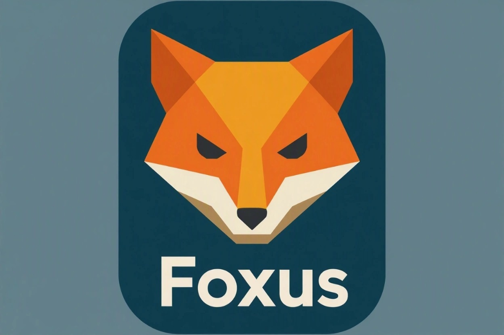

# FOXUS 🦊 — AI-Powered Anti-Procrastination Companion

> **Hacktoberfest ESPOL: Clubs Royale** · Open Source (`Apache-2.0`) · Impulsado por **Google Gemma 4** (`gemma-4-26b-a4b-it`)

<p align="center">
  
</p>

## 1. El Problema y la Propuesta de Valor

La procrastinación académica rara vez ocurre por falta de capacidad: ocurre por **resistencia al inicio** ante tareas percibidas como grandes, ambiguas o intimidantes (*"Preparar 12 diapositivas"*, *"Estudiar cinco capítulos de cálculo"*).

**FOXUS** no es un gestor pasivo de listas de pendientes. Transforma tareas grandes en **microacciones físicas de pocos minutos** y las presenta mediante *hooks* opcionales, empáticos y gamificados tanto en **Android (Jetpack Compose)** como en un **prototipo físico de smartwatch con ESP32 + LCD 16×2 + pulsadores**.

---

## 2. Arquitectura Multiagente + Google Gemma 4

Todo el razonamiento generativo utiliza exclusivamente el modelo abierto **Google Gemma 4 (`gemma-4-26b-a4b-it`)** mediante el SDK oficial `google-genai` (Gemini API), gobernado por motores deterministas:

- **FOXUS Orchestrator (`orchestrator.py`):** Controlador determinista con trazabilidad completa por `trace_id`.
- **Context Agent (`context_agent.py`):** Analiza tareas reales, fechas límite, eventos de calendario e historial de rechazos sin inventar disponibilidad.
- **Microtask Agent (`microtask_agent.py`):** Convierte tareas intimidantes en una microacción inmediata (60–300 s) con adaptación automática de dificultad si hubo rechazos previos.
- **Hook Agent (`hook_agent.py`):** Selecciona y redacta la intervención ideal, el minijuego emergente de 30s (`catch_fox` / `spark_combo`) y las líneas habladas en vivo del árbitro (`coach_voice_lines`).
- **Referee Agent (`referee_agent.py`):** Agente multimodal impulsado por la visión nativa de **Google Gemma 4 (`gemma-4-26b-a4b-it`)** que evalúa la evidencia final del estudiante (**foto de su avance** o **nota de voz transcrita**) y dicta retroalimentación hablada en tiempo real.
- **Learning Agent (`learning_agent.py`):** Motor estadístico en Python (`adaptive_ucb_v1`) que aprende qué hooks producen inicios y finalizaciones reales, preparado para *Thompson Sampling* / *contextual bandits*.
- **Policy Engine & Reward Engine:** Reglas deterministas para horarios silenciosos, *cooldown*, tope de intensidad y otorgamiento idempotente de XP.

---

## 3. Estructura del Monorepositorio

```text
FoxUS/
├── android/               # App nativa Kotlin + Jetpack Compose + Material 3 (Hito 3-4)
├── backend/               # API FastAPI + Agentes Gemma 4 + SQLAlchemy 2 + Alembic (Hito 1-2)
├── firmware/esp32_foxus/  # Firmware PlatformIO Arduino para ESP32 + LCD 16x2 (Hito 5)
├── dashboard/             # Panel analítico opcional en Streamlit (Hito 6)
├── assets/                # Logo oficial intacto, licencias de recursos, audio y animaciones
├── docs/                  # Arquitectura, flujo multiagente, base de datos y referencia API
├── docker-compose.yml     # PostgreSQL 16 local alternativo
├── LICENSE                # Apache License 2.0
└── README.md
```

---

## 4. Configuración Rápida del Backend (Windows + Python 3.12 / 3.14)

### Requisitos verificados
Compatible nativamente con **Python 3.14.7** (ruedas binarias `cp314-win_amd64` verificadas) y **Python 3.12+**, conectado a **Supabase PostgreSQL (Session Pooler IPv4)** o PostgreSQL local en Docker.

```powershell
# 1. Crear entorno virtual e instalar dependencias
python -m venv backend\.venv
.\backend\.venv\Scripts\python.exe -m pip install -r backend\requirements.txt

# 2. Configurar variables de entorno (nunca subir backend/.env a Git)
Copy-Item backend\.env.example backend\.env
# Editar backend/.env con DATABASE_URL, GEMINI_API_KEY y tokens de demostración

# 3. Aplicar migraciones Alembic en PostgreSQL
.\backend\.venv\Scripts\python.exe -m alembic -c backend\alembic.ini upgrade head

# 4. Ejecutar pruebas automatizadas
.\backend\.venv\Scripts\python.exe -m pytest -c backend\pytest.ini backend\tests

# 5. Iniciar servidor FastAPI en desarrollo
.\backend\.venv\Scripts\python.exe -m uvicorn app.main:app --app-dir backend --reload --host 0.0.0.0 --port 8000
```

---

## 5. Estado de Hitos de Ingeniería

- [x] **Hito 1 — Fundación del Repositorio y Persistencia:** Estructura monorepo, licencia Apache-2.0, marca oficial en `assets/brand/foxus_logo.png`, entorno `.venv` Python 3.14.7 verificado, conexión real Supabase PostgreSQL (`SELECT 1`), 12 tablas con SQLAlchemy 2 + Psycopg 3 + Alembic y `/api/v1/health`.
- [x] **Hito 2 — Inteligencia Multiagente con Gemma 4:** Contratos Pydantic v2, `GemmaClient` (`gemma-4-26b-a4b-it`), `ContextAgent`, `MicrotaskAgent`, `HookAgent`, `LearningAgent`, `PolicyEngine`, `RewardEngine`, `FoxusOrchestrator`, endpoints completos `/api/v1/*` y suite `pytest`.
- [x] **Hito 3 — Aplicación Android (Kotlin + Jetpack Compose):** Identidad visual FOX, ícono adaptable y monocromático, mascota geométrica animada `FoxMascot`, navegación MVVM, Home, Tasks, FOX Challenge y Agent Debug conectados al backend (`app-debug.apk` compilado y probado).
- [x] **Hito 4 — Gamificación, Audio (`FoxAudioManager`) y Modo FOX BZZ:** 10 recursos WAV originales (`Apache-2.0 / CC0-1.0`), `FoxAudioManager` (`SoundPool` + `Media3 ExoPlayer` con `AudioFocusRequest`), pantalla interactiva **FOX BZZ (*La Mosca Traviesa*)**, pantalla de **Recompensas/Historial**, **Modo Presión Inteligente** (interrupción gestual tipo Duolingo + notificaciones emergentes + overlay voluntario), sincronización real con **Google Tasks y Google Calendar**, y pantalla **Smartwatch ESP32 + Simulador de 3 Pulsadores**.
- [x] **Hito 5 — Prototipo Smartwatch ESP32 + LCD I2C 16×2 + 3 Pulsadores:** Firmware PlatformIO no bloqueante (`millis()` + `INPUT_PULLUP` con antirrebote) en `firmware/esp32_foxus/src/main.cpp`, máquina de estados completa y guías en `docs/esp32_wiring.md` y `docs/device_protocol.md`.
- [x] **Hito 6 — Observabilidad Multiagente, Dashboard Opcional y Guion de Demo:** Traza completa por `trace_id` en Android (`AgentDebugScreen`), panel técnico auxiliar en `dashboard/streamlit_app.py` y guion oficial de presentación en `docs/hackathon_demo.md`.

---

## 6. Licencia

Código fuente distribuido bajo **Apache License 2.0** ([`LICENSE`](LICENSE)). Consulta [`assets/ASSETS_LICENSES.md`](assets/ASSETS_LICENSES.md) para los detalles de marca y recursos multimedia.

## Enganches y perfil

Continuidad por actividad, momentos multimedia e historias exportables: [flujo y límites de la demo](docs/momentum.md).

El perfil incluye métricas de foco registrado, ritmo por unidad, avances y un zorrito
personalizable. Las continuaciones admiten temporizador o cronómetro.

## Demo física sin Internet

El proyecto [foxus_hook_demo](firmware/foxus_hook_demo) conecta Android directamente
al ESP32 por Wi-Fi local. El botón **THE HOOK!** activa un buzzer y muestra la microacción
en una TFT redonda GC9A01 de 240×240. No requiere Supabase ni el backend.

Consulta el [cableado, carga con PlatformIO y guion de demostración](docs/demo_hook_local.md).
Este firmware es independiente del prototipo anterior con LCD 16×2.
