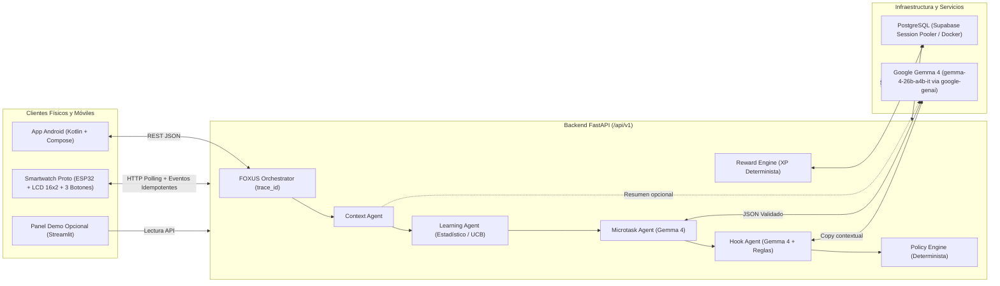

# FOXUS — Arquitectura del Sistema

## Visión General

**FOXUS** es un compañero anti-procrastinación open source diseñado para transformar tareas percibidas como grandes o intimidantes en **microacciones inmediatas** presentadas mediante intervenciones opcionales, ligeras y motivadoras (*hooks*).

## Principios Arquitectónicos

1. **Modelo Central Abierto:** Todo razonamiento generativo utiliza exclusivamente **Google Gemma 4** (`gemma-4-26b-a4b-it`) invocado mediante el SDK oficial `google-genai` (Gemini API). El validador de configuración bloquea modelos propietarios distintos de `gemma-*`.
2. **Separación Estricta de Responsabilidades:**
   - Los agentes generativos (`MicrotaskAgent`, `HookAgent`, y opcionalmente `ContextAgent`) proponen acciones y mensajes validados con Pydantic v2.
   - El `PolicyEngine` aplica horarios silenciosos, límites de enfriamiento (*cooldown*), permisos y tope de intensidad de forma determinista.
   - El `RewardEngine` asigna XP con claves de idempotencia únicas (`idempotency_key`), impidiendo que la IA invente recompensas o que reintentos de red dupliquen puntos.
   - El `LearningAgent` calcula métricas reales de inicio, finalización y rechazo mediante algoritmos estadísticos deterministas en Python (`adaptive_ucb_v1`), preparado para *contextual bandits* / *Thompson Sampling*.
3. **Transparencia ante Fallos de Red o Ausencia de API Key:** Cuando `GEMINI_API_KEY` no está configurada o el proveedor falla tras reintentos acotados, el sistema activa un respaldo determinista etiquetado explícitamente como `model_name="deterministic_fallback"` e `is_simulated_ai=true`. Nunca se presenta una salida simulada como ejecución real de Gemma.
4. **Seguridad de Datos:** El APK de Android y la ESP32 jamás se conectan directamente a PostgreSQL ni almacenan credenciales de Supabase o de Gemini API.
